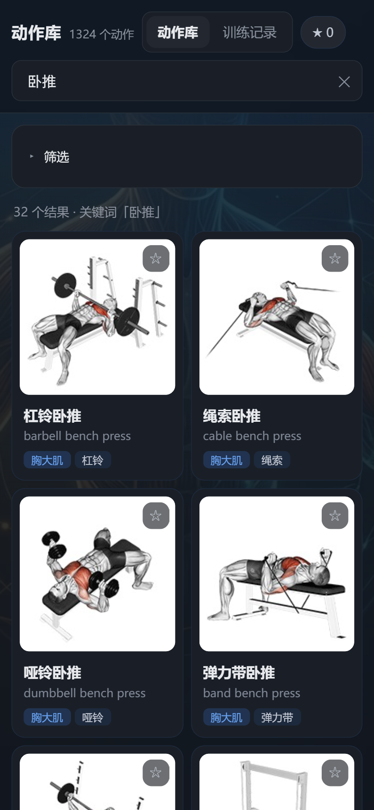
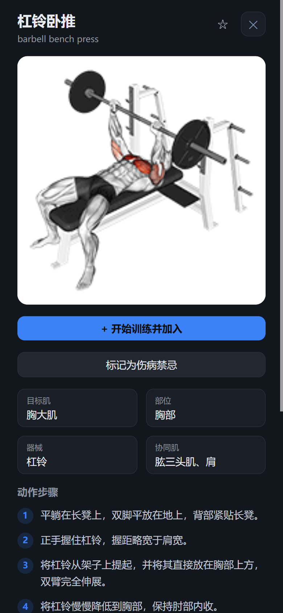
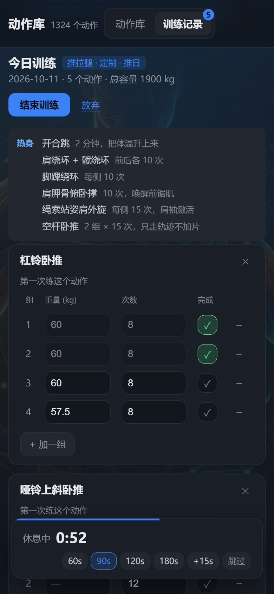

# 动作库 · 健身助手

**在线使用：<https://yuan-20022.github.io/fitness-app/>**

手机上打开后选「添加到主屏幕」，它就是一个独立 App —— 有自己的图标、全屏打开、**没网也能用**
（首次加载需要联网缓存，之后不用）。不需要装任何东西，也没有账号。

1324 个健身动作的中文检索 + 训练计划 + 训练记录。纯前端、无后端、无账号，数据全在本地。

<p align="center">
  
  
  
</p>

解决的实际问题：

- **找动作**：不用再反复开视频 App——搜「卧推」「腘绳肌」「哑铃」，拿中文分步说明和动画演示
- **按计划练**：选一个训练计划，它告诉你今天练哪些动作、几组几次、该上多少重量，一键填入
- **记训练**：记组数重量次数，下次练同一动作**自动带出上次的数据**，方便判断该不该加重量

## 快速开始

**只是想用**：直接打开 <https://yuan-20022.github.io/fitness-app/> 就行，下面这些都不用做。

**想在本地跑一份**：

```bash
git clone https://github.com/yuan-20022/fitness-app.git
cd fitness-app
npm install
npm run dev             # http://localhost:5173
```

**这就够了。** 动作数据（`public/data/exercises.json`，1 MB）已经在仓库里，媒体是可选依赖 ——
没有图也能正常用，只是每个动作的位置显示「无图」。`npm test`（94 个用例，约 400ms）
和 `npm run build` 也都不需要额外的步骤。

这几步是在一个全新 clone 里实际跑过才写进来的 —— 早先这一节让人先跑 `data:fetch-raw`
拉 17.4 MB，但那一步**根本不需要**：数据文件本来就入库了。

手机访问：`npm run dev` 会打印 Network 地址，手机连同一 WiFi 打开即可。

### 可选：把图也拉下来

```bash
npm run media:fetch          # 1324 张缩略图，8.5 MB
npm run media:fetch-videos   # 再加 122 MB 的 GIF
```

**没拉之前 `npm run build` 会有一条警告**，说 `media/*.json` 匹配不到任何文件 ——
那是因为 `media/index.json`（媒体清单）跟着媒体一起生成，不拉就没有。
**构建照样成功**（exit 0），只是离线时没有图可以缓存。那不是坏了。

### 可选：重建数据集

`public/data/exercises.json` 已经入库，**一般不需要重建**。只有改了中文名映射
（`data/name-overrides.json`）、或者上游数据集更新时才需要：

```bash
npm run data:fetch-raw  # 拉上游原始数据（17.4 MB，需代理见下）
npm run data:build      # 清洗 + 裁剪 → public/data/exercises.json
```

### 代理

Node 的 `fetch` **不读 `HTTP_PROXY` 环境变量**，在国内直连 GitHub 会全部静默失败。
`fetch-media.mjs` 检测到代理时会自动带 `NODE_USE_ENV_PROXY=1` 重启自己，无需手动处理。
如果代理没配环境变量，手动指定：

```bash
HTTPS_PROXY=http://127.0.0.1:7897 npm run media:fetch
```

## 命令

| 命令 | 作用 |
|---|---|
| `npm run dev` | 开发服务器 |
| `npm run build` | 类型检查 + 生产构建 |
| `npm run typecheck` | 只做类型检查 |
| `npm test` | 跑单元测试（纯函数，几百毫秒） |
| `npm run test:watch` | 测试的 watch 模式 |
| `npm run data:fetch-raw` | 拉上游原始数据 |
| `npm run data:build` | 重建精简数据集（改清洗规则/术语表后跑） |
| `npm run data:profile` | 数据集体检：规模、维度分布、中文覆盖率 |
| `npm run media:fetch` | 下载缩略图（8.5 MB） |
| `npm run media:fetch-videos` | 下载动画 GIF（122 MB） |
| `npm run icons` | 重新生成 PWA 图标（哑铃图形，手写 PNG 编码） |
| `npm run check:programs` | 校验模板与有氧收尾里的动作 ID 是否都存在、是不是该有的类型（已挂进 `build`） |

## 目录

```
data/                        原始数据（不直接进前端）
  exercises.json             上游 17.4 MB 原始数据集（不进版本库）
  name_zh.json               中文名映射
  terms.zh.json              部位/器械/目标肌 中英术语表
  name-overrides.json        人工校正表（10 条）
  programs.json              六个训练计划模板
  warmups.json               七个热身方案（21 个训练日共用）
  LICENSE / NOTICE.md        上游授权声明，不要删
scripts/
  profile.mjs                数据集体检
  build-data.mjs             清洗 + 裁剪 → 精简数据集
  fetch-raw.mjs              拉上游原始数据集
  fetch-media.mjs            媒体下载 + 生成清单
  check-programs.mjs         校验模板里的动作 ID / 热身方案名（已挂进 build）
  make-icons.mjs             生成 PWA 图标（手写 PNG 编码）
  lib/proxy-bootstrap.mjs    让 Node 的 fetch 读 HTTP_PROXY（见上文「代理」）
src/
  lib/data.ts                加载 / 搜索 / 筛选 / 媒体清单与路径（查不到返回 null，没有兜底）
  lib/useFavorites.ts        收藏夹（localStorage）
  lib/useWorkouts.ts         训练记录：增删动作与组、上次成绩、进步曲线
  lib/usePrograms.ts         归你所有的计划 + 当前跟随哪一套（localStorage）
  lib/useContraindications.ts 伤病禁忌
  lib/programs.ts            模板加载、加重建议、递增组、按天摊开、快照、轮转推导
  lib/recommend.ts           按使用者情况挑模板 + 裁剪（**不生成计划**，见下）
  lib/backup.ts              导出 / 导入备份：形状校验与版本兼容（当前 v4）
  lib/date.ts                本地日期。**任何「哪一天」的值都必须走这里**
  lib/id.ts                  新记录 id。非安全上下文下 crypto.randomUUID 不存在
  lib/alert.ts               计时提示音 + 震动，含 iOS 的手势解锁
  components/FilterBar       三维筛选（手机上默认收起 —— 展开时占首屏六成）
  components/ExerciseCard    动作卡片
  components/DetailPanel     动作详情抽屉
  components/WorkoutPanel    训练记录页
  components/ProgramPanel    计划面板：选计划、切换训练日、一键开始
  components/ProgramList     计划列表：选用多个模板、切换、新建
  components/ProgramEditor   计划编辑器：改训练日、动作、组数、次数区间、热身
  components/PlanWizard      按 4 个问题推荐一份计划，并逐条说明改了什么
  components/ContraindicationSection  伤病禁忌：单个标记 + 按部位批量添加
  components/ExercisePicker  选动作（复用同一套搜索）
  components/RestTimer       组间休息倒计时
  components/ProgressChart   最大重量走势
public/
  data/exercises.json        精简数据集 0.69 MB（前端实际加载的）
  media/images/              1324 张缩略图（8.5 MB）
  media/videos/              1324 个动画 GIF（122 MB，可选）
  media/index.json           本地已有媒体的清单（67 KB，**必须预缓存**，理由见 vite.config.ts）
```

术语以 [CONTEXT.md](CONTEXT.md) 为准；几个绕不开的设计决定写在 [docs/adr/](docs/adr/)；
优化建议与待办收在 [docs/backlog.md](docs/backlog.md)。

## 动作库（检索）

**打开时不显示任何结果。** 选了部位或器械、或者输入了搜索词，结果才出来。

理由是量出来的：全摊开的时候，375px 的手机上「1324 个结果」的第一张卡片要滚到
**653px** 才出现，而屏幕只有 812px 高 —— 也就是说打开动作库，你看到的是搜索框加
一片 chip，看不到任何动作。而 1324 这个数字本身既不是选项也不是答案，它是一面墙。

配套的三条：

- **手机上筛选面板是展开的**，因为那时候它**就是**内容。一旦出了结果就自动收起，
  让卡片回到第一屏（478px → 109px）；点一下还能再展开。
- **收起时必须把已选条件摆出来**，而且能单点移除。否则条件还在生效、结果却少了，
  使用者看不出是为什么 —— 这种「安静地少给东西」是这个项目反复踩到的同一类坑。
- **桌面上面板一直开着。** 宽度够，不给人多一次点击。

判定「缩过范围」的是「有搜索词 / 有筛选 / 只看收藏」三者之一，和屏幕宽度无关；
屏幕宽度只决定面板开不开。

搜索是多词 AND + 权重排序（`src/lib/data.ts` 的 `search`），筛选三组来自数据聚合。
列表一次渲染 48 个，其余按需加载。

## 热身

每个训练日开头有一段练前准备，分两层：

1. **一般性**——开合跳升体温、关节绕环开活动度
2. **针对性**——按当天练什么激活：推日做肩胛骨俯卧撑，拉日做肩胛引体向上，腿日做臀桥和弓步

**练前不做静态拉伸。** 动作库里有 57 条拉伸，绝大多数是静态的——那是练后做的，
练前做反而降低随后的力量输出。热身方案里一条静态拉伸都没有。

热身条目分两种，界面上看得出来：**带演示的**（动作库里有：肩胛骨俯卧撑、绳索站姿肩外旋、
踝关节绕环…）能点开看动画；**纯文字的**（开合跳、关节绕环、空杆活动）是动作库里没有的——
那是个健美动作库，不是热身库。

### 递增组：热身里最有价值的一段

一般性热身只升体温，针对性激活只叫醒肌肉，**只有递增组能让神经系统按正式组的重量和轨迹工作一遍**。
而且它**能算**——工作重量定了，几组几片就定了：

```
工作重量 62.5kg → 20×10 → 25×5 → 37.5×3 → 50×1
```

（空杆起，然后 40% / 60% / 80%，按 2.5kg 取整，且不超过工作重量。低于 40kg 就不给递增组了——
空杆已经占了太大比例。）

递增组**只显示、不记录**：它不算容量，也不参与「上次成绩」和加重建议。挂在当天第一个有建议重量的动作上，
全身只做一次，不是每个动作都重来。

热身方案在 `data/warmups.json` 里定义，21 个训练日共用 7 个方案——每个训练日抄一遍既冗长又容易改漏。
编辑器里改过某天的热身后，那天就存成显式数组，不再跟方案走。

## 训练计划与加重建议

内置**七个模板**（`data/programs.json`）：推拉腿、上下肢分化、三分化（胸/背/腿）、
四分化（胸/背/肩臂/腿）、五分化（胸/背/肩/臂/腿）、推拉蹲（复合为主）、5x5 力量。
模板是**只读的起点**——选用后它被复制成一份**归你所有、可以随便改**的计划，
之后模板怎么更新都影响不到它。可以同时存多套（增肌期一套、减脂期一套），随时切换。

### 按你的情况推荐一份

回答四个问题（训练经验、一周能来几天、每次练多久、主要目标），从上面这七个模板里挑一个，
再把模板裁成适合你的量。每一步改动都会逐条列出来，创建之后在编辑器里能改回去。

**四个问题里只有三个真的会改变结果**，每一件都能讲清楚：

| 问题 | 改什么 |
|---|---|
| 一周能来几天 | 选哪个模板；并**按训练经验压上限**（新手说能来 6 天也只排 3 天） |
| 每次练多久 | 每个训练日最多留几个动作（裁掉的是排在后面的孤立动作） |
| 主要目标 | 见下表 |

| 目标 | 次数区间 | 有氧收尾 |
|---|---|---|
| 增肌为主 | 沿用模板原样 | 无 |
| 力量为主 | 主项降到 3~5 次，其余不动 | 无 |
| 塑形 / 减脂为主 | 整体上移（偏重的复合动作 10~12，其余 15~20） | 每个训练日末尾加一个自重有氧 |

有氧收尾从 `data/programs.json` 的 `cardioFinishers` 里取，按经验由易到难
（开合跳 → 登山者 → 波比跳）。**必须是「有氧 + 自重」**：自重才不需要先知道你的健身房里
有没有那台机器。名单里的动作 id 和模板 id 走同一套校验（`npm run check:programs`）。

**它会如实告诉你这仍然是一份力量计划。** 选「塑形 / 减脂」的人期待的是另一类课程，
而这个库的 1324 个动作有 1295 个是按肌群切的力量动作——凑不出真正的有氧或减脂课程，
那需要另一套动作库。这句提示是推荐结果的一部分，不是免责小字。

同样地，它也不替你挑动作（「练不了卧推？试试这个」这类）——理由见
[伤病禁忌](#伤病禁忌)一节。有氧收尾是唯一的例外，所以它有三重限制：
只在塑形 / 减脂下发生、只挑不需要器械的、挑了什么在说明里明说并提醒可以删。

计划编辑器能改：计划名、增肌/减脂说明、每个训练日的名称与练哪里、增删训练日并调整顺序、
增删动作并调整顺序、每个动作的组数与次数区间。也可以从空白新建一份自己排。
派生自模板的计划随时能「恢复模板初始状态」。

**编辑不影响历史。** 每次训练都存了当时计划的快照，所以你把推日的卧推从 `4组×6~8次` 改成
`6组×5次` 之后，三个月前那条记录里显示的还是 `计划 4 组 × 6~8 次 · 实际做了 3 组`——
历史反映当时发生了什么，不是模板今天长什么样。见 [docs/adr/0001](docs/adr/0001-workout-embeds-program-day-snapshot.md)。

你编辑过的计划**必须进备份**（v3 起）。只存 `programId` 不存定义的话，换台设备恢复
就会把你的自定义计划全丢掉。

**加重建议是这个模块的实质。** 规则就是渐进超负荷最朴素的做法：

> 上次**所有组**都做到了次数区间的上限 → 加一档重量重来；没做满 → 维持重量先把次数补齐。

加重的档位按器械定，不是拍脑袋的偏好，而是现实约束：

| 器械 | 每次加 | 原因 |
|---|---|---|
| 杠铃 / 史密斯机 / 固定器械 / 绳索 | 2.5 kg | 最小配重片两片共 2.5kg |
| 哑铃 | 2 kg | 通常 2kg 一档 |
| 壶铃 | 4 kg | 通常 4kg 一档 |
| 自重 / 弹力带 | — | 加不了重量，改成加次数 |

**模板用动作 ID 引用动作库，不用名字。** 这个数据集里没有 `barbell squat`（叫 `barbell full squat`）、
没有 `lat pulldown`（叫 `lateral pulldown`）、还有带 `°` 符号的名称，靠名字匹配迟早出错。
ID 稳定。`npm run check:programs`（已挂进 `build`）校验模板里每个 ID 都存在、
每天内不重复、组数和次数区间合法——模板写错一个 ID，用户点「开始」时才发现少动作，那太晚了。

### 训练记录内嵌计划快照

每次从计划开始训练，当时那个训练日的安排被**整个抄一份**进 `Workout`：计划名、训练日名、
以及每个动作的 `(id, 中文名, 组数, 次数区间)`。见 [docs/adr/0001](docs/adr/0001-workout-embeds-program-day-snapshot.md)。

为什么必须冗余：计划可编辑、模板会更新、动作会下架。只存引用的话，改一次计划，
三个月前的历史就跟着变了——**而且不报错，只是安静地变错**。

快照带来的两个能力：

- **Deviation**：历史里显示「计划 4 组 × 6~8 次 · 实际做了 3 组」，也能标出「计划外」的动作
- **历史永远可读**：动作从库里下架后，靠快照里的中文名仍读得懂

### 轮转按训练日名字推导，不是按下标

「下一个该练哪天」= 找出上次练的训练日**名字**，在当前计划里按名字定位，取它的下一位。

不能写成 `(上次下标 + 1) % 天数`。在计划里**插入或重排一个训练日**会让所有历史记录的下标语义
整体偏移一位，轮转从此错乱。已实测：训练日列表从 `[推日,拉日,腿日]` 变成
`[手臂日,推日,拉日,腿日]` 后，历史记着「推日（下标 0）」，按下标会算出「推日」（让你再练一遍），
按名字才算对「拉日」。

只有名字找不到了（训练日被改名或删除）才退回按下标。

### 加重建议只看同一套计划的记录

不同计划的训练意图不同（增肌 5 次 vs 减脂 15 次），成绩不可比。减脂期「60kg 做满 15 次该加重」
搬到增肌期就荒谬了——你本来是 80kg。自由训练自成一组，不参与计划的建议。

### 两个踩过的坑

**一、预填 ≠ 实际做了**

从计划开始训练时，每个动作的组都会预填好建议重量和次数。第一版按「字段非空」判断哪些组要存进历史，
结果**你根本没练的动作也进了历史**（因为它被预填了次数），进而污染了「上次成绩」和加重建议。

修法是给每个组加 `touched` 标记：**只有你打勾过、或亲手填过重量次数的组才算数**。
预填的组在你碰它之前不算。同时「结束训练」按钮在没有任何实际记录前是禁用的，容量也只统计实际做了的组。

**二、`toISOString()` 是 UTC**

备份文件名曾经用 `exportedAt.slice(0, 10)`，那是 UTC。在东八区，本地时间**早于 08:00**
时 UTC 还停在前一天（本地 07:00 = UTC 前一天 23:00），于是「今天」被写成**昨天**。
早上 8 点之后两者重合，所以白天随手一试是测不出来的。现在统一走 `src/lib/date.ts` 的 `localDate()`。

**注意方向**：是**凌晨**出问题、写成**前一天**，不是「晚上 8 点之后写成第二天」——
本地 20:00 = UTC 12:00，还在同一天。这条注释原先写反了，是加测试时才发现的
（`date.test.ts` 里那条用例同时也在守着时区，见 [vitest.config.ts](vitest.config.ts) 里为什么要把 TZ 钉死）。

`toISOString()` 用在**时间戳**上是对的（`finishedAt`、`exportedAt`），
但任何当作「哪一天」用的值都必须走 `localDate()`。

从计划开始训练时，每个动作的组都会预填好建议重量和次数。第一版按「字段非空」判断哪些组要存进历史，
结果**你根本没练的动作也进了历史**（因为它被预填了次数），进而污染了「上次成绩」和加重建议。

修法是给每个组加 `touched` 标记：**只有你打勾过、或亲手填过重量次数的组才算数**。
预填的组在你碰它之前不算。同时「结束训练」按钮在没有任何实际记录前是禁用的，容量也只统计实际做了的组。

## 伤病禁忌

给某个动作打上「这段时间不适合我」的标记，通常在伤的时候。被标记的动作**不会出现在计划安排里**，
但**在动作库中仍然搜得到**——它不是删除动作，标记只是提醒。

- **标记入口**：动作详情页单个标记（可填预计恢复日和备注），或在训练记录页「按部位批量添加」
  （选部位 → 列出候选 → 自己勾）
- **在计划里**：被禁动作标灰、划掉、写明原因，旁边一个「仍要练」按钮 —— 禁忌是**提醒不是禁令**。
  覆盖只对当前这次有效，不改标记本身
- **开始训练时**被禁动作被排除，快照里也不记它们（快照记的是「这次打算练什么」）
- **提示**：一整天全被禁 → 「先去解除禁忌，或者换个训练日」；只剩 1 个可练 → 「练下来会缺一大块」

**到期不自动解除。** 填了预计恢复日，到点只提示「还在疼吗？」，解除由你自己点。
自动解除会在你没注意的时候把受伤动作塞回计划——这和 `touched` 那个 bug 是同一类错误：
程序自作主张改用户数据。

**不做自动替代推荐。** 不给你「练不了卧推？试试这个」这种建议——替代动作是专业教练知识，
猜错了比不给更糟，因为你会信它。

禁忌从备份 v4 起随备份走。重建一份禁忌表要回忆哪疼、什么时候开始，很烦。

## 训练记录

完全存在浏览器 localStorage（`fitness:workouts`），没有服务端，换设备不同步。

**设计上的几个取舍：**

- **自动带出上次成绩**是核心，不是"记下来"。健身做加重量决策全靠「上次 60kg 做了 8 次」这条信息，
  每次训练每个动作都显示在名字下方。
- **加一组时继承上一组的重量次数**。连着做组时数字通常不变，少敲几次键盘。
- **新组默认不打勾**，打勾才计容量并触发休息计时。避免误记。
- **总容量 = Σ 重量 × 次数**。自重动作没填重量按 0 计，不污染数字。
- **重量/次数用字符串存**，不用 number。因为输入框允许是空的（自主动作），也允许半输入状态
  （比如刚敲了「6」还没敲完「60」），用 number 会把这些中间态变成 0 或 NaN。
- **进步曲线按「日期 → 结束时间」排序**。只按日期排的话，同一天练两次顺序不稳定，曲线会反向，
  看起来像退步——这是会误导训练决策的那种错。
- **日期用本地时间算**，不能用 `toISOString()`。那是 UTC，晚上练会被记成第二天。

**已知不足：**

- **数据不跨设备同步。** 训练记录只在这一个浏览器的 localStorage 里——手机记的，电脑上看不到，
  反之亦然。唯一的搬运方式是「导出备份」再「导入备份」。想真正同步得加后端，
  三条路的取舍见 [docs/backlog.md](docs/backlog.md)。
- **同一天练两次同一个动作时**，曲线两个点的 x 轴标签都是同一天，看不出先后（趋势方向是对的）。
- **离线时只有看过的动作图能显示。** 缩略图 8.5 MB 不进预缓存（会和 122 MB 的 GIF 一起把安装拖死），
  改成「看过就缓存」。所以健身房信号不好时，没点开过的动作是没有图的——文字说明、组数、记录都不受影响。

## 数据管道做了什么

原始中文名是机器翻译，直接用在界面上很难看。`build-data.mjs` 做三件事：

1. **去翻译碎片**——英文复数/介词的残骸被留在了中文里：
   `摆臂悬垂直腿s` ← legs、`哑铃肱二头肌弯举带抬腿d` ← raised、`过a 凳` ← over a bench。
   判据：拉丁串 ≤2 字符、全小写、且与中文相邻。大写保留（`V字起身`、`JM卧推`、`SZ杆` 都是合法的）。
2. **去分词空格**——中文之间不该有空格：`辅助 仰卧 抬腿带侧向 下摆` → `辅助仰卧抬腿带侧向 下摆`。

   中↔拉丁、中↔数字之间的空格保留。
3. **裁剪与翻译**——丢掉用不上的 8 种语言说明，补上筛选维度的中文标签。

效果：1324 条从 17.4 MB 压到 0.69 MB，零条需要人工介入。

搜索能同时命中中文名、英文原名、目标肌、器械、部位、协同肌，多词用空格分隔是 AND 关系。

## 许可

| 部分 | 许可 |
|---|---|
| 应用代码、数据管道、中文名与清洗 | **MIT** —— 见 [LICENSE](LICENSE) |
| 上游动作数据集 | **MIT**，© Hasan Emir Yıldırım —— 见 [data/LICENSE](data/LICENSE) |
| 动作演示图片与 GIF | **© Gym visual — https://gymvisual.com/**，**不在本仓库、也不在 MIT 范围内** |

**媒体**（缩略图与 GIF）以 180×180 分辨率使用，**必须保留署名** —— 界面上每个动作详情页
底部都会显示那行署名，不要去掉。媒体不进版本库（见 `.gitignore`），由 CI 在构建时从上游拉取，
所以克隆这个仓库不会连带拿到那些图。

**克隆本仓库不等于拿到媒体的许可。** 想在自己的项目里用这套媒体，先读
[Gym visual 的使用条款](https://gymvisual.com/content/3-terms-and-conditions-of-use)并自行取得授权。
详见 [data/NOTICE.md](data/NOTICE.md)。

本项目面向个人自用。若要商业化，需先处理上面那条媒体授权，或换用
[free-exercise-db](https://github.com/yuhonas/free-exercise-db)（Unlicense 公共领域）。

## 部署（手机上用）

本地跑的问题是：**手机得连同一个 WiFi** 才能打开。而训练记录是在健身房做的，
那里用的是流量、不在家网——所以在健身房根本用不了。要解决只能发布到 HTTPS 上。

**线上地址：<https://yuan-20022.github.io/fitness-app/>**（2026-10-11 上线）
仓库 `yuan-20022/fitness-app`，`main` 分支推送即自动部署。手机用 Chrome/Safari 打开，
选「添加到主屏幕」，就是一个独立 App。

### 局域网调试 ≠ 线上环境

有个不明显的区别值得记住：**局域网 HTTP 不是安全上下文**。
在 `http://192.168.x.x:5173` 下实测：

| | `localhost:5173` | 局域网 IP | 线上 HTTPS |
|---|---|---|---|
| `isSecureContext` | true | **false** | true |
| `crypto.randomUUID` | 有 | **undefined** | 有 |
| `navigator.serviceWorker` | 有 | **undefined** | 有 |

也就是说，**PWA 在局域网下根本试不出来**——「添加到主屏幕」和离线缓存必须部署到 HTTPS
才能验证。而 `crypto.randomUUID` 在那个环境下是 `undefined`，调用会抛异常并让 React
卸载整棵树（页面变空白）。所以 `src/lib/id.ts` 里那个 `getRandomValues` 兜底不是多余的，
它保证局域网调试这条路能走（见该文件的注释）。

### GitHub Pages

**前置：仓库必须是 public。** 免费账号开不了 private 仓库的 Pages，需要 GitHub Pro。

```bash
gh repo create <用户>/fitness-app --public --source=. --remote=origin
```

推送前**还要开 Pages 并把 Source 设为 GitHub Actions**，否则 `deploy-pages` 会失败：

```bash
gh api -X POST repos/<用户>/fitness-app/pages -f build_type=workflow
```

之后 `git push origin main` 即可，workflow 跑完就上线。

**发布前先确认一件事**：`*.github.io` 在部分网络环境下访问不稳定。
手机浏览器打开 `https://yuhonas.github.io/free-exercise-db/` 试一下，
能秒开就说明可用；打不开或很慢，就换下面的方案。

### 备选：Cloudflare Pages / Vercel

两者都可以连 **private** 仓库，免费，且国内可达性通常好于 github.io。
配置：构建命令 `npm run build`，输出目录 `dist`，其余同 GitHub Pages。
需要先在浏览器里授权它们的 GitHub App——这一步得你自己点。

### 部署相关的四个坑

- **`vite.config.ts` 里的 `BASE` 必须和仓库名一致**。项目站点在 `/<仓库名>/` 下，
  写死 `/data/...` 会全部 404。dev 和 build 用同一个 base，避免路径 bug 只在发布后暴露。
  **所以仓库一旦定名就不能随便改**，改名要同步改 `BASE`。
- **媒体不进仓库**（140 MB），由 CI 在构建时现拉（见 workflow 里的 `media:fetch`）。
  否则每次 CI 都要 checkout 140 MB。
- **`gh` 的 token 必须额外持有 `workflow` scope 才能推 `.github/workflows/` 下的文件**，
  否则推送会被**原子拒绝**（远端不会有任何部分推送成功，看不出推到了哪一步）。
  报错是 `refusing to allow an OAuth App to create or update workflow ... without workflow scope`。
  修法：`gh auth refresh -h github.com -s workflow`，会在浏览器里走一次设备授权。
- **`workflow_dispatch` 不受 `paths-ignore` 影响**。workflow 里配了纯文档改动不触发部署，
  但那只对 `push` 生效；真需要重跑时去 Actions 页面点 Run workflow 即可。

## 已知取舍

- **媒体文件是可选依赖**。缩略图 8.5 MB，GIF 122 MB。两者都不在版本库里（见 `.gitignore`）。
  没有媒体时应用**照常能用**，只是图的位置显示「无图」。不再回退到第三方取图——
  那份媒体的授权只随本应用走，而且原来的兜底域名（`raw.githubusercontent.com`）国内基本不通，
  它给的不是图，是超时。没下 GIF 时详情页显示静态图并标注「动画需下载 GIF」。
- **部分中文名仍偏机械**，如「辅助坐姿胸肌大肌拉伸稳定球」。这是上游翻译的底子，
  遇到读着别扭的，在 `data/name-overrides.json` 里加一条 `"动作id": "改好的名字"` 再跑 `data:build`。
- **列表一次渲染 48 个**，其余按需加载。1324 个动作一次性挂载会明显卡顿。
- **打开动作库时列表是空的**，要先搜或先筛。这不是坏了，原因见[动作库（检索）](#动作库检索)。
- **没有后端**。收藏和训练记录都在浏览器 localStorage，换设备/清缓存就没了。
